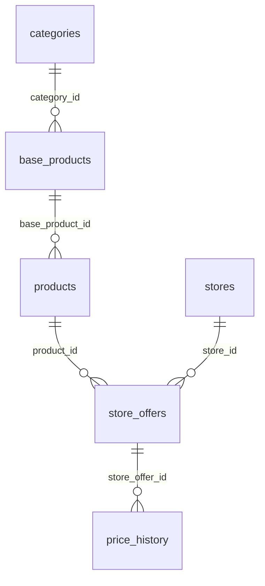

# Kontekst bazy produktów i cen

**Archiwum sprzed migracji z 14 listopada 2026.** Aktualny schemat i naprawione RPC opisuje [database-context.md](database-context.md). Przywołany niżej stary eksport zachowano w `tests/fixtures/legacy-schema.sql`.

Źródło obowiązujące: [supabase-schema.sql](../supabase-schema.sql), eksport zdalnej bazy przekazany przez autora projektu 14 listopada 2026, godz. 15:45 (Europe/Warsaw).
SHA-256 eksportu: `ac04bb2c6bdc61b95683e24ec2075221d101f9fff5be0f5bed80fcbf6a03b5ee`.
Schemat zawiera sześć tabel, jeden widok, pięć funkcji aplikacyjnych i trzy triggery w `public`, a także rozszerzenia, sekwencje, indeksy, ograniczenia, polityki RLS i uprawnienia.
Dokument zastępuje wcześniejszy opis oparty na [rozmowie z Gemini](https://share.gemini.google/pWceqiJjSxxU). Rozmowa pozostaje źródłem historii importu, nie aktualnych definicji funkcji.

Eksport jest migawką struktury bez rekordów. Nie potwierdza aktualnej liczby produktów ani zawartości słowników.
Po zmianie bazy należy ponowić eksport i odświeżyć dokumentację. Samo zapisanie pliku nie synchronizuje go z Supabase.

Kontekst całego repozytorium i najnowsze wyniki testów zawiera [stan projektu z 14 listopada](stan-projektu.md).
Nowy `supabase/config.toml` jest domyślną konfiguracją lokalnego CLI, a nie eksportem Auth projektu w chmurze. Różnice ustawień opisuje [supabase-setup.md](supabase-setup.md).

## Wynik kontroli RPC — 14 listopada 2026

Po odczycie eksportu wykonano cztery odczytowe wywołania RPC w zdalnym projekcie, z publicznym kluczem, bez zapisu danych:

| Wywołanie | Wynik |
| --- | --- |
| `compare_basket([], false, false)` | HTTP 404, PostgreSQL `42883`: `function round(double precision, integer) does not exist` |
| `compare_basket([], false, true)` | Ten sam błąd `42883` |
| `search_offers('', 1)` | HTTP 400, PostgreSQL `42703`: `column so.base_product_id does not exist` |
| `search_offers('mleko', 1)` | Ten sam błąd `42703` |

Obecność funkcji w eksporcie nie oznacza, że można jej obecnie użyć. Obie funkcje RPC wymagają poprawek przed integracją z ekranami aplikacji.
Poniżej opisano ich zamierzoną logikę na podstawie aktualnego kodu SQL oraz konkretne niespójności. Nie zmieniano zdalnej bazy ani kodu aplikacji.

## Zakres i stan integracji

Baza PostgreSQL w Supabase przechowuje katalog produktów, wartości odżywcze, oferty sieci handlowych i historię cen.
Supabase Auth obsługuje konta osobno; poniższy schemat `public` nie definiuje tabel użytkowników, list zakupów, ulubionych, przepisów, lodówki ani paragonów.

W obecnym kodzie SMARTCART Supabase jest podłączony do uwierzytelniania. Nie ma jeszcze zapytań do poniższych tabel, widoku ani RPC.
Mapa pobiera pojedyncze placówki przez lokalny serwer Node.js z `dane-sklepow/gotowe/sklepy.json`.
Tabela `public.stores` oznacza **sieci handlowe**, a nie placówki z mapy. Nie przechowuje adresów ani współrzędnych i nie ma klucza do rekordów mapy.

Sieci w bazie ofert według wcześniejszego importu: Biedronka, Lidl, Kaufland, Carrefour, Dino; eksport struktury nie potwierdza bieżącej zawartości `stores`.
Sieci na obecnej mapie: Biedronka, Lidl, Auchan, Dino.
Identyfikatorów liczbowych sieci nie należy zgadywać; do ich wyszukania służy `slug`.

Historyczne liczby podane w rozmowie po imporcie, bez potwierdzenia aktualności przez eksport:

| Encja | Liczba |
| --- | ---: |
| Sieci `stores` | 5 |
| Działy `categories` | 10 |
| Produkty bazowe `base_products` | 224 |
| Produkty fizyczne `products` | 8335 |
| Oferty `store_offers` | 9163 |
| Wpisy `price_history` | 8486 |

Według opisu 677 ofert nie miało ceny regularnej. Są zachowane m.in. dla wyszukiwania EAN i wartości odżywczych.

## Relacje



Produkt bazowy to np. „Mleko UHT”; produkt fizyczny to konkretny wariant, marka i opakowanie.
Oferty tego samego produktu fizycznego mogą istnieć w wielu sieciach.
Produkt bazowy grupuje potencjalne zamienniki, ale samo przypisanie do grupy nie zapewnia identycznej gramatury ani cech produktu.

## Tabele w schemacie `public`

W tabelach poniżej pola są opcjonalne (`NULL`), chyba że zaznaczono `NOT NULL` lub klucz główny.
`SERIAL` i `BIGSERIAL` generują identyfikatory. Wszystkie pola `created_at` mają `NOT NULL DEFAULT NOW()`.

### `stores`

| Kolumna | Typ / ograniczenia |
| --- | --- |
| `id` | SERIAL PRIMARY KEY |
| `slug` | VARCHAR(32) NOT NULL UNIQUE |
| `name` | VARCHAR(64) NOT NULL UNIQUE |
| `logo_url` | TEXT |
| `is_active` | BOOLEAN NOT NULL DEFAULT TRUE |
| `created_at` | TIMESTAMPTZ |

Slugi z wcześniejszego skryptu importu: `biedronka`, `lidl`, `kaufland`, `carrefour`, `dino`. Eksport nie zawiera INSERT-ów potwierdzających te wartości.

### `categories`

| Kolumna | Typ / ograniczenia |
| --- | --- |
| `id` | SERIAL PRIMARY KEY |
| `name` | VARCHAR(64) NOT NULL UNIQUE |
| `display_order` | SMALLINT NOT NULL DEFAULT 0 |
| `created_at` | TIMESTAMPTZ |

Działy we wcześniejszym skrypcie inicjalizacji: Warzywa i Owoce, Pieczywo, Nabiał, Mięso i Ryby, Mrożonki i Gotowe, Sypkie i Makarony, Tłuszcze i Przetwory, Przyprawy i Pieczenie, Napoje, Słodycze i Przekąski. Eksport nie potwierdza ich bieżącej zawartości.

### `base_products`

| Kolumna | Typ / ograniczenia |
| --- | --- |
| `id` | SERIAL PRIMARY KEY |
| `category_id` | INT NOT NULL FK → categories.id, ON DELETE RESTRICT |
| `name` | VARCHAR(120) NOT NULL UNIQUE |
| `default_shelf_life_days` | SMALLINT NOT NULL DEFAULT 7, > 0 |
| `median_kcal_100g` | NUMERIC(6,1), 0–905 |
| `median_protein_100g` | NUMERIC(5,1), 0–100 |
| `median_fat_100g` | NUMERIC(5,1), 0–100 |
| `median_carbs_100g` | NUMERIC(5,1), 0–100 |
| `created_at` | TIMESTAMPTZ |

Według wcześniejszego importera mediany są agregowane z dostępnych danych produktów podczas importu. `default_shelf_life_days` jest wartością domyślną dla przyszłego modułu lodówki, a nie datą ważności konkretnego opakowania.
W aktualnej tabeli nie ma kolumny `search_tags`, mimo że odwołuje się do niej funkcja `search_offers`.

### `products`

| Kolumna | Typ / ograniczenia |
| --- | --- |
| `id` | BIGSERIAL PRIMARY KEY |
| `product_key` | VARCHAR(64) NOT NULL UNIQUE |
| `base_product_id` | INT NOT NULL FK → base_products.id, ON DELETE RESTRICT |
| `ean` | VARCHAR(20) UNIQUE |
| `canonical_name` | TEXT NOT NULL |
| `gramatura_norm` | VARCHAR(24) |
| `quantity_value` | NUMERIC(10,2), > 0 |
| `quantity_unit` | VARCHAR(10), `g`, `ml` lub `szt` |
| `kcal_100g` | NUMERIC(6,1), 0–905 |
| `protein_100g` | NUMERIC(5,1), 0–100 |
| `fat_100g` | NUMERIC(5,1), 0–100 |
| `carbs_100g` | NUMERIC(5,1), 0–100 |
| `off_scans` | INT NOT NULL DEFAULT 0, >= 0 |
| `image_url` | TEXT |
| `created_at` | TIMESTAMPTZ |
| `updated_at` | TIMESTAMPTZ NOT NULL DEFAULT NOW(), trigger przy UPDATE |

EAN jest tekstem, co zachowuje początkowe zera. Może być pusty dla produktów bez rozpoznanego kodu.
Przykłady `gramatura_norm`: `500g`, `1500ml`, `10szt`.
Klucz importu to `ean:<kod>` albo `name:<md5>` wyliczany z produktu bazowego, oczyszczonej nazwy i gramatury.
`off_scans` pochodzi z Open Food Facts i nie oznacza liczby zakupów w SMARTCART.

### `store_offers`

| Kolumna | Typ / ograniczenia |
| --- | --- |
| `id` | BIGSERIAL PRIMARY KEY |
| `offer_key` | VARCHAR(64) NOT NULL UNIQUE |
| `store_id` | INT NOT NULL FK → stores.id, ON DELETE CASCADE |
| `product_id` | BIGINT NOT NULL FK → products.id, ON DELETE CASCADE |
| `store_product_name` | TEXT NOT NULL |
| `regular_price` | NUMERIC(10,2), > 0 |
| `promo_price` | NUMERIC(10,2), > 0 |
| `promo_type` | VARCHAR(64) |
| `promo_condition` | TEXT |
| `valid_from` | DATE |
| `valid_to` | DATE |
| `price_status` | VARCHAR(20) NOT NULL DEFAULT 'brak': `prawdziwa`, `estymowana`, `brak` |
| `price_source` | VARCHAR(32) NOT NULL DEFAULT 'brak' |
| `image_url` | TEXT |
| `created_at` | TIMESTAMPTZ |
| `updated_at` | TIMESTAMPTZ NOT NULL DEFAULT NOW(), trigger przy UPDATE |

Unikalna jest również para `(store_id, product_id)`. Gdy obie ceny istnieją, `promo_price < regular_price`.
Ceny są traktowane w rozmowie jako PLN; tabela nie ma pola waluty.
Klucz importu: `<store_id>:<product_key>`.
Źródła obejmują m.in. `antonka`, `tanszykoszyk`, `kodyzbiedry`; `price_source` nie ma zamkniętej listy wartości w CHECK.
Brak ceny oznacza `NULL`, nie zero. Status `estymowana` trzeba odróżniać od ceny zaobserwowanej.

### `price_history`

| Kolumna | Typ / ograniczenia |
| --- | --- |
| `id` | BIGSERIAL PRIMARY KEY |
| `store_offer_id` | BIGINT NOT NULL FK → store_offers.id, ON DELETE CASCADE |
| `regular_price` | NUMERIC(10,2) |
| `promo_price` | NUMERIC(10,2) |
| `price_source` | VARCHAR(32) |
| `recorded_at` | TIMESTAMPTZ NOT NULL DEFAULT NOW() |

Trigger `trg_log_price_change`, funkcja `fn_log_price_change`:

- INSERT oferty zapisuje historię, gdy istnieje przynajmniej jedna cena.
- UPDATE zapisuje historię, gdy cena regularna lub promocyjna zmieniła się według `IS DISTINCT FROM`.
- Zmiana samych warunków promocji, źródła lub dat nie tworzy wpisu.
- `recorded_at` to czas zapisu w bazie, niekoniecznie czas obserwacji ceny u źródła.

Funkcja `fn_set_updated_at()` ustawia `NEW.updated_at = NOW()` i zwraca `NEW`.
Wywołują ją triggery `trg_products_updated_at` i `trg_store_offers_updated_at`, oba `BEFORE UPDATE FOR EACH ROW` na odpowiednich tabelach.
Z kolei `trg_log_price_change` działa `AFTER INSERT OR UPDATE FOR EACH ROW` na `store_offers`.

## Widok `v_store_offers_full`

Łączy oferty z produktami, produktami bazowymi, działami i sieciami. Kolumny z aktualnego eksportu, w kolejności widoku:

```text
offer_id, store_id, store_slug, store_name,
category_id, category_name, base_product_id, base_product_name,
default_shelf_life_days,
product_id, ean, product_name, gramatura_norm, quantity_value, quantity_unit,
regular_price, is_promo_active, is_multibuy_promo,
active_promo_price, effective_price, single_item_price,
discount_pct, price_per_unit_100,
promo_type, promo_condition, valid_from, valid_to,
price_status, price_source, image_url,
kcal_100g, protein_100g, fat_100g, carbs_100g, off_scans
```

`product_name` pochodzi z `store_offers.store_product_name`.
`image_url` wybiera zdjęcie oferty, a następnie zdjęcie produktu (`COALESCE`).
`price_per_unit_100` oznacza cenę za 100 g, 100 ml albo 1 sztukę, zależnie od jednostki.

Promocja jest aktywna, jeśli `promo_price IS NOT NULL`, `valid_from` jest puste lub nie późniejsze niż `CURRENT_DATE`, a `valid_to` jest puste lub nie wcześniejsze niż `CURRENT_DATE`.
Daty początku i końca są uwzględniane włącznie. Sprawdzanie `valid_from` zostało dodane względem starego opisu.

- `active_promo_price` zwraca cenę aktywnej promocji lub `NULL`.
- `effective_price` wybiera cenę aktywnej promocji, a w przeciwnym razie cenę regularną. Uwzględnia także promocje wielosztukowe.
- `is_multibuy_promo` sprawdza obecność `promo_price` oraz dopasowanie `promo_type` do wyrażenia regularnego `(przy zakupie|gratis|drugi|trzeci|\d+\s*\+\s*\d+|wielopak)`, bez rozróżnienia wielkości liter. Sama ta flaga nie sprawdza dat.
- `single_item_price` używa aktywnej promocji tylko wtedy, gdy `promo_type` nie pasuje do powyższego wzorca; w pozostałych przypadkach zwraca cenę regularną.

Ograniczenia tej implementacji, istotne dla dalszych prac:

- Wielosztuki są rozpoznawane heurystycznie tylko po `promo_type`, nie po `promo_condition`.
- Nie weryfikuje wymaganej liczby sztuk, karty lojalnościowej, limitów ani pozostałych warunków opisowych. `single_item_price` także nie gwarantuje ceny bezwarunkowej, np. gdy oferta wymaga karty.
- Nie filtruje `stores.is_active` ani `price_status = 'estymowana'`.
- Podane ceny wymagają oceny warunków przed prezentowaniem ich jako bezwarunkowego kosztu zakupu.

## RPC `compare_basket`

Aktualna, jedyna definicja tej funkcji w eksporcie:

```sql
compare_basket(
  p_base_product_ids integer[],
  p_allow_multibuy boolean DEFAULT true,
  p_normalize_weight boolean DEFAULT false
)
```

To funkcja `LANGUAGE plpgsql STABLE`, bez `SECURITY DEFINER` w eksporcie.
Zamierzona logika:

1. Dla każdego żądanego produktu bazowego oblicza medianę `quantity_value` z ofert w widoku z dodatnią ilością. Mediana jest liczona po ofertach, więc ten sam produkt dostępny w kilku sieciach może być liczony wielokrotnie.
2. Przy `p_allow_multibuy = true` wybiera `effective_price`; przy `false` wybiera `single_item_price`. Pomija oferty z pustą wybraną ceną.
3. Przy `p_normalize_weight = true` przelicza wybraną i regularną cenę proporcjonalnie do medianowej ilości produktu bazowego i zaokrągla do dwóch miejsc. Gdy ilość lub mediana nie jest dodatnia, pozostawia cenę opakowania.
4. Wybiera najtańszą porównywalną ofertę dla każdej pary sieć–produkt bazowy.
5. Sumuje ceny dla aktywnych sieci i sortuje po pokryciu malejąco, potem po sumie rosnąco.

Domyślne wywołanie z samą tablicą ID dopuszcza wielosztuki i nie normalizuje ilości.

Zwraca:

```text
store_id INT
store_name VARCHAR
matched_items_count INT
total_requested_count INT
total_basket_price NUMERIC
total_regular_price NUMERIC
total_savings NUMERIC
```

Sygnatura deklaruje ceny jako `NUMERIC`; wewnętrzne sumy są rzutowane na `NUMERIC(10,2)`.

**Potwierdzony błąd wykonania:** `PERCENTILE_CONT(0.5)` dla `quantity_value` daje medianę typu `double precision`. W wyrażeniu `ROUND((cena / quantity_value) * median_qty, 2)` powstaje wywołanie `round(double precision, integer)`, którego serwer nie rozpoznaje (`42883`). Błąd występuje również przy wyłączonej normalizacji, podczas przygotowania zapytania. Naprawa powinna zapewnić arytmetykę `numeric` przed dwuargumentowym `ROUND`, np. przez jawne rzutowanie mediany. Nie zastosowano takiej zmiany w bazie.

Pozostałe ograniczenia logiki:

- Bez normalizacji sumuje ceny jednego opakowania najtańszej oferty. Z normalizacją sumuje wartości proporcjonalne do mediany, które nie muszą odpowiadać kosztowi zakupu całych opakowań.
- Nie przyjmuje żądanych ilości, gramatur ani listy konkretnych EAN.
- Normalizacja grupuje wyłącznie po `base_product_id`, bez sprawdzenia `quantity_unit`; nie chroni przed mieszaniem g, ml i szt w jednej grupie.
- Mediana uwzględnia także oferty bez ceny i oferty nieaktywnych sieci. Wybór docelowych sieci aktywnych następuje dopiero w końcowej agregacji.
- Nie rozwiązuje warunków promocji i dziedziczy ograniczenia widoku.

Niepełny koszyk może mieć niską sumę; trzeba zawsze pokazywać pokrycie. Brak dopasowań daje sumę zero przez `COALESCE`.
Powtórzone ID w tablicy są liczone wielokrotnie przez `ARRAY_LENGTH`, ale wybór ofert przez `ANY` nie powiela pozycji. Do obecnego RPC należy przekazywać unikalne ID.
Suma cen regularnych i oszczędności korzysta z semantyki `SUM` dla `NULL`; nie musi obejmować wszystkich pozycji koszyka z ceną efektywną.

## Funkcje `norm_text` i `search_offers`

`norm_text(t text) RETURNS text`, `LANGUAGE sql IMMUTABLE`: zamienia `NULL` na pusty tekst, usuwa akcenty przez `public.unaccent`, zamienia litery na małe, zastępuje znaki spoza `[a-z0-9%]` spacjami i usuwa skrajne spacje. Znak `%` zostaje zachowany.

`search_offers(search_query text DEFAULT '', result_limit integer DEFAULT 40)`, `LANGUAGE plpgsql STABLE`, ma zwracać:

```text
id INTEGER, name TEXT,
regular_price NUMERIC, promo_price NUMERIC,
normalized_weight TEXT, image_url TEXT, kcal_100g NUMERIC,
store_name TEXT, base_product_name TEXT, relevance_score NUMERIC
```

Zamierzona logika wyszukiwania:

- Normalizuje zapytanie przez `norm_text`.
- Dla pustego zapytania sortuje po obecności dowolnej ceny promocyjnej malejąco, potem po ID, i przypisuje wynikowi 100 punktów.
- Dla tekstu sumuje punkty za nazwę produktu bazowego (120 lub 90), synonimy `search_tags` (100 lub 75), nazwę oferty (60 lub 10) oraz podobieństwo trigramowe (do 50).
- Wstępnie filtruje po zawieraniu zapytania lub progach `word_similarity`: 0,38 dla produktu bazowego i tagów, 0,42 dla nazwy oferty.
- Zachowuje wyniki z wynikiem co najmniej 22, sortuje po punktach malejąco, następnie po `COALESCE(promo_price, regular_price)` rosnąco i nakłada `result_limit`.

**Potwierdzony błąd wykonania:** dla pustego i niepustego zapytania zwraca `42703`: `column so.base_product_id does not exist`.
Analiza eksportu ujawnia więcej odwołań do nieistniejących kolumn:

| Odwołanie w funkcji | Stan aktualnego schematu |
| --- | --- |
| `so.base_product_id` | Nie istnieje w `store_offers`; relacja do produktu bazowego prowadzi przez `products.base_product_id` |
| `so.name` | Nazwa w `store_offers` to `store_product_name` |
| `so.normalized_weight` | Gramatura jest w `products.gramatura_norm` |
| `so.kcal_100g` | Wartość jest w `products.kcal_100g` |
| `bp.search_tags` | Nie ma takiej kolumny w `base_products` |

Dodatkowo deklarowane `id INTEGER` różni się od `store_offers.id BIGINT`, a `store_name TEXT` od `stores.name VARCHAR(64)`. Przy naprawie należy dopasować także typy zwracane.
Obecny kod nie uwzględnia dat promocji, warunków wielosztuk ani aktywności sieci i nie filtruje ofert bez ceny.
Nie należy podłączać tej wersji do wyszukiwarki aplikacji bez naprawy i ponownego sprawdzenia.

## Odczyt, zapis i indeksy

W eksporcie wszystkie sześć tabel ma włączone RLS z politykami SELECT `USING (true)` bez zawężenia roli. Nie ma polityk INSERT, UPDATE ani DELETE.
Eksport zapisuje dla `anon` i `authenticated` uprawnienia `SELECT, REFERENCES, TRIGGER, TRUNCATE, MAINTAIN` do wszystkich sześciu tabel oraz widoku; analogiczny zestaw jest w domyślnych uprawnieniach przyszłych tabel tworzonych przez `postgres` w `public`.
Nie należy opisywać tego zestawu jako uprawnień ograniczonych do SELECT. Brak polityk zapisu RLS nie oznacza braku wszystkich pozostałych uprawnień.
`service_role` ma `ALL` do tabel, widoku i sekwencji. Importer z wcześniejszej rozmowy używa tego klucza poza aplikacją mobilną; klient Expo korzysta z publicznego klucza i sesji użytkownika.
Widok ma właściciela `postgres`; w jego definicji nie ma opcji `security_invoker`. Funkcje aplikacyjne nie deklarują `SECURITY DEFINER` ani własnego `SET search_path`.
Jawne GRANT-y funkcji obejmują m.in. `norm_text` i `search_offers`. Skuteczne wywołanie obu RPC potwierdzono do etapu wykonania ich SQL: odpowiedzi zawierają błędy zapytania, nie odmowę dostępu.
Publiczny odczyt katalogu w tym schemacie jest szerszy niż ochrona logowaniem obecnego lokalnego API mapy.

Indeksy obejmują klucze obce, EAN, GIN `pg_trgm` na `products.canonical_name`, ceny i daty promocji ofert oraz historię `(store_offer_id, recorded_at DESC)`.
Rozszerzenia w eksporcie: `pg_trgm` i `unaccent` w `public`; `pg_stat_statements`, `pgcrypto` i `uuid-ossp` w `extensions`; `supabase_vault` w `vault`.

Ustalenia do wykorzystania przy integracji:

- Listę ofert można pobierać z `v_store_offers_full`; w porównywarce należy wykluczać `effective_price IS NULL` i uwzględniać opisane ograniczenia cen.
- Wyszukiwanie EAN korzysta z `products.ean`, także dla produktów bez oferty z ceną.
- Działającym polem nazwy produktu jest `products.canonical_name`; widok wystawia nazwę oferty jako `product_name`. Istniejące RPC `search_offers` wymaga naprawy opisanej wyżej.
- Zapytania listujące wymagają stronicowania; importer w rozmowie używa paczek i stron, zamiast zakładać pobranie całego katalogu jednym SELECT.
- Skrypty przygotowania/importu danych z rozmowy nie są obecne w aktualnym repozytorium aplikacji.

Ten dokument zachowuje kontekst aktualnego eksportu i wynik kontroli RPC. Nie wykonuje schematu, importu, zmian RLS ani migracji istniejącej bazy.
